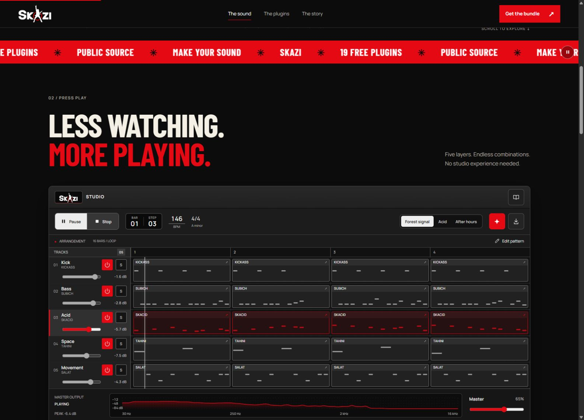

<div align="center">
  
</div>

<h1 align="center">SKAZI Bundle</h1>

<p align="center"><strong>19 free instruments, effects and MIDI tools by Asher Swissa.</strong><br>
One installer for Windows. One for Mac.</p>

<p align="center">
  <a href="https://github.com/slazoasher/skazi-bundle/releases/latest/download/SKAZI.Bundle.Setup.exe"><strong>Download for Windows</strong></a>
  &nbsp;·&nbsp;
  <a href="https://github.com/slazoasher/skazi-bundle/releases/latest/download/SKAZI.Bundle.pkg"><strong>Download for Mac</strong></a>
  &nbsp;·&nbsp;
  <a href="https://github.com/slazoasher/skazi-bundle/releases/latest">Release notes</a>
</p>

<p align="center">
  <a href="#install">Install</a> · <a href="#plugin-collection">Plugin collection</a> · <a href="#try-it-in-your-browser">Browser studio</a> · <a href="#troubleshooting">Troubleshooting</a>
</p>

## Install

| Platform | Installer | Formats |
| :--- | :--- | :--- |
| Windows 64-bit | [SKAZI.Bundle.Setup.exe](https://github.com/slazoasher/skazi-bundle/releases/latest/download/SKAZI.Bundle.Setup.exe) | VST3 and standalone apps |
| macOS, Intel and Apple silicon | [SKAZI.Bundle.pkg](https://github.com/slazoasher/skazi-bundle/releases/latest/download/SKAZI.Bundle.pkg) | VST3, Audio Units and standalone apps |

1. Download and run the installer for your system. On Windows, select the plugins you want to install.
2. Open your DAW and look for **SKAZI** in the plugin browser. Rescan if the plugins do not appear. Use **AU** in Logic Pro or GarageBand, and **VST3** in a VST3 host.
3. Load an instrument on an instrument or MIDI track, or put an effect on an audio track. Pick a preset and play. For standalone use, look for the included apps in the Windows Start menu or in `/Applications/SKAZI/` on Mac.

> [!NOTE]
> The current installers are distributed without Windows code signing or Apple Developer ID signing, so your system may display a security prompt. Get the installer from the [official GitHub release](https://github.com/slazoasher/skazi-bundle/releases/latest), where you can check the asset name and release notes.

## Plugin collection

| Plugin | What it does | Presets |
| :--- | :--- | ---: |
| [**SKAZI**](SKAZI-Synth/) | Psytrance, acid and virtual analog synthesis | 3,650 |
| [**BULLY**](Bully/) | Wavetable synthesis | 462 |
| [**SKAZI 303**](TBON303/) | 303-style acid basslines | 544 |
| [**BAMBA**](Bamba/) | Risers and uplifts | 260 |
| [**TAHINI**](Tahini/) | Delay and reverb | 250 |
| [**SUBICH**](Subich/) | Bass and sub-bass synthesis | 1,000 |
| [**ZHUG**](Zhug/) | Saturation and stereo widening | — |
| [**SALAT**](Salat/) | Glitch and multi-effects processing | 104 |
| [**KICKASS**](Kickass/) | Kick drum synthesis | 50 |
| [**MIDI GOD**](MidiGod/) | MIDI pattern generation and audio-to-MIDI conversion | 126 |
| [**KUBE**](Kube/) | Psytrance wavetable synthesis | 306 |
| [**QUAZI**](Quazi/) | Four-band distortion | 104 |
| [**SHAKSUKA**](Shaksuka/) | Random chopping and glitch effects | 509 |
| [**PITA PUMP**](PitaPump/) | Sidechain-style volume shaping | 105 |
| [**The FilterFish**](FilterFish/) | Filtering, tempo-synced delay and 11 reverb types | 800 |
| [**SKACID**](Skacid/) | Acid bassline synthesis with Accent and Slide | 129 |
| [**SKILTER**](Skilter/) | Morphing multimode filter | 150 |
| [**SKWIDE**](Skwide/) | Stereo imaging | 70 |
| [**SKAZI REVERB**](Skverb/) | Reverb with freeze, ducking and pre-delay | 75 |

## Try it in your browser

[](https://sergey-bar.github.io/skazi-bundle/?v=50#lab)

Press **Play** to hear *Forest Signal*, a 16-bar psytrance loop built with samples rendered from KICKASS, SUBICH and SKACID. Play the on-screen keys, edit the groove, mix the tracks and export a stereo WAV.

[Open SKAZI Studio](https://sergey-bar.github.io/skazi-bundle/?v=50#lab) · [Watch the project trailer](https://sergey-bar.github.io/skazi-bundle/review/skazi-trailer.html?v=2)

## Troubleshooting

- **A plugin is missing.** Check that your DAW scans the right format and rescan. The installer places VST3 plugins in the `SKAZI` subfolder of your system VST3 directory.
- **Where are the files?** On Windows, check `C:\Program Files\Common Files\VST3\SKAZI\` for plugins and `C:\Program Files\SKAZI\` for apps. On Mac, check `/Library/Audio/Plug-Ins/VST3/SKAZI/`, `/Library/Audio/Plug-Ins/Components/` or `/Applications/SKAZI/`.
- **Updating an existing installation.** Download the latest installer from Releases. Plugin IDs are kept stable so existing DAW projects can find the updated plugins. Check the release notes for changes that affect your setup.
- **Uninstalling.** On Windows, remove **SKAZI Bundle** under Installed apps. On Mac, run **Uninstall SKAZI Bundle.command** from `/Applications/SKAZI/`.
- **Reporting a problem.** Include your OS, DAW and version, plugin name and format, bundle version, and the steps to reproduce it. [Open an issue](https://github.com/slazoasher/skazi-bundle/issues/new).

## Source and builds

The plugins are free to download and the source is available in this repository. The folder links in the collection take you to each plugin's code.

<details>
<summary>Build the bundle or add a plugin</summary>

### Windows

Install Visual Studio 2022 with the C++ workload, CMake and Git. From PowerShell in the repository root:

```powershell
.\build_bundle.ps1
```

The installer is written to `dist\SKAZI Bundle Setup.exe`. Use `-PluginsOnly` to build the plugins or `-InstallerOnly` to package a previous build. The installer supports `/silent` and `/uninstall`.

### macOS

From the repository root on a Mac:

```bash
bash mac/build_mac.sh
```

The script builds for Intel and Apple silicon and writes `dist/SKAZI Bundle.pkg`. Both platform builds are also defined in the [bundle workflow](.github/workflows/build-bundle.yml).

### Adding a plugin

1. Add the plugin folder with a JUCE CMake configuration and the **SKAZI** vendor name. Keep existing plugin IDs stable when updating a plugin.
2. Update the platform build scripts, the Windows installer, and the [Mac installer resources](mac/).
3. Add the plugin to the [website catalog](docs/demo/plugins.json) and update the collection in this README.

Shared UI components live in [Common](Common/).

</details>
