<div align="center">
  
</div>

<h1 align="center">SKAZI Bundle</h1>

<p align="center"><strong>19 free instruments, effects and MIDI tools by Asher Swissa.</strong><br>
One installer for Windows. One for Mac.</p>

<p align="center">
  <a href="https://github.com/slazoasher/skazi-bundle/releases/latest/download/SKAZI.Bundle.Setup.exe"><strong>Download for Windows</strong></a>
  &nbsp;·&nbsp;
  <a href="https://github.com/slazoasher/skazi-bundle/releases/latest/download/SKAZI.Bundle.pkg"><strong>Download for Mac</strong></a>
  &nbsp;·&nbsp;
  <a href="https://github.com/slazoasher/skazi-bundle/releases/latest">Release notes</a>
</p>

<p align="center">
  <a href="#install">Install</a> · <a href="#plugin-collection">Plugin collection</a> · <a href="#try-it-in-your-browser">Browser studio</a> · <a href="#troubleshooting">Troubleshooting</a>
</p>

## Install

| Platform | Installer | Formats |
| :--- | :--- | :--- |
| Windows 64-bit | [SKAZI.Bundle.Setup.exe](https://github.com/slazoasher/skazi-bundle/releases/latest/download/SKAZI.Bundle.Setup.exe) | VST3 and standalone apps |
| macOS, Intel and Apple silicon | [SKAZI.Bundle.pkg](https://github.com/slazoasher/skazi-bundle/releases/latest/download/SKAZI.Bundle.pkg) | VST3, Audio Units and standalone apps |

1. Download and run the installer for your system. On Windows, select the plugins you want to install.
2. Open your DAW and look for **SKAZI** in the plugin browser. Rescan if the plugins do not appear. Use **AU** in Logic Pro or GarageBand, and **VST3** in a VST3 host.
3. Load an instrument on an instrument or MIDI track, or put an effect on an audio track. Pick a preset and play. For standalone use, look for the included apps in the Windows Start menu or in `/Applications/SKAZI/` on Mac.

> [!NOTE]
> The current installers are distributed without Windows code signing or Apple Developer ID signing, so your system may display a security prompt. Get the installer from the [official GitHub release](https://github.com/slazoasher/skazi-bundle/releases/latest), where you can check the asset name and release notes.

## Plugin collection

Browse all 19 plugins by category. Select a screenshot to enlarge it or a plugin name to view its source.

### Instruments

<table>
<tbody>
  <tr>
    <td width="33%" valign="top">
      <a href="docs/img/bamba-960.webp">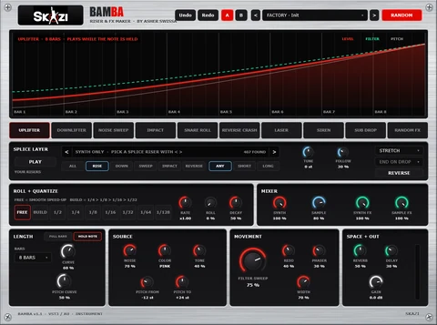</a><br>
      <strong><a href="Bamba/">BAMBA</a></strong><br>
      Riser &amp; uplift maker<br>
      <sub>260 presets</sub>
    </td>
    <td width="33%" valign="top">
      <a href="docs/img/bully-960.webp">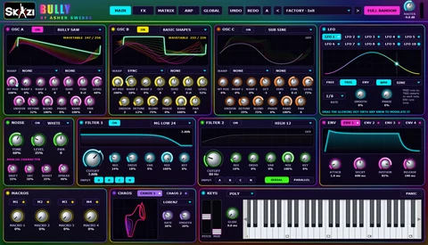</a><br>
      <strong><a href="Bully/">BULLY</a></strong><br>
      Analog-character wavetable monster<br>
      <sub>462 presets</sub>
    </td>
    <td width="33%" valign="top">
      <a href="docs/img/kickass-960.webp">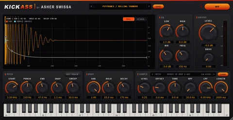</a><br>
      <strong><a href="Kickass/">KICKASS</a></strong><br>
      Kick drum synth<br>
      <sub>50 presets</sub>
    </td>
  </tr>
  <tr>
    <td width="33%" valign="top">
      <a href="docs/img/kube-960.webp">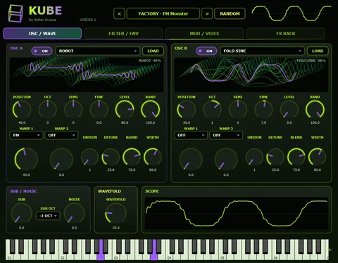</a><br>
      <strong><a href="Kube/">KUBE</a></strong><br>
      Psytrance wavetable synth<br>
      <sub>306 presets</sub>
    </td>
    <td width="33%" valign="top">
      <a href="docs/img/skacid-960.webp">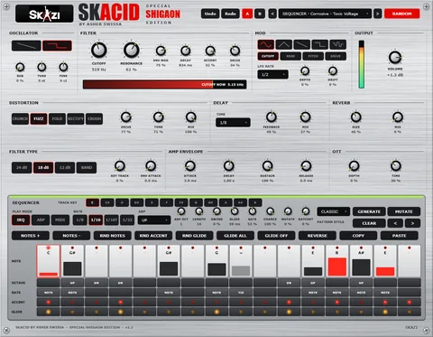</a><br>
      <strong><a href="Skacid/">SKACID</a></strong><br>
      Acid bassline synth · Special Shigaon Edition<br>
      <sub>129 presets</sub>
    </td>
    <td width="33%" valign="top">
      <a href="docs/img/skazi-960.webp">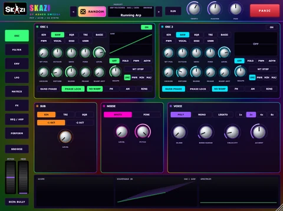</a><br>
      <strong><a href="SKAZI-Synth/">SKAZI</a></strong><br>
      Psy / acid / VA synth<br>
      <sub>3,650 presets</sub>
    </td>
  </tr>
  <tr>
    <td width="33%" valign="top">
      <a href="docs/img/subich-960.webp">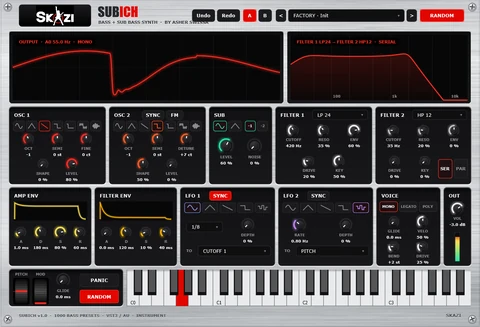</a><br>
      <strong><a href="Subich/">SUBICH</a></strong><br>
      Bass + sub bass synth<br>
      <sub>1,000 presets</sub>
    </td>
    <td width="33%" valign="top">
      <a href="docs/img/tbon303-960.webp">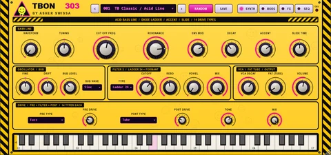</a><br>
      <strong><a href="TBON303/">TBON 303</a></strong><br>
      Acid bass line synth<br>
      <sub>544 presets</sub>
    </td>
  </tr>
</tbody>
</table>

### Effects

<table>
<tbody>
  <tr>
    <td width="33%" valign="top">
      <a href="docs/img/pitapump-960.webp">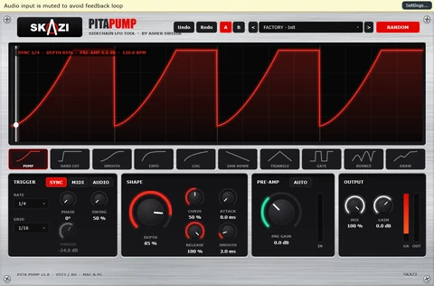</a><br>
      <strong><a href="PitaPump/">PITAPUMP</a></strong><br>
      Sidechain LFO tool<br>
      <sub>105 presets</sub>
    </td>
    <td width="33%" valign="top">
      <a href="docs/img/quazi-960.webp">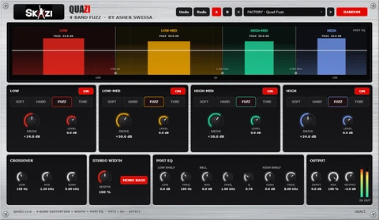</a><br>
      <strong><a href="Quazi/">QUAZI</a></strong><br>
      4-band fuzz<br>
      <sub>104 presets</sub>
    </td>
    <td width="33%" valign="top">
      <a href="docs/img/salat-960.webp">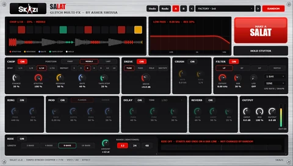</a><br>
      <strong><a href="Salat/">SALAT</a></strong><br>
      Glitch multi-FX + RISE<br>
      <sub>104 presets</sub>
    </td>
  </tr>
  <tr>
    <td width="33%" valign="top">
      <a href="docs/img/shaksuka-960.webp">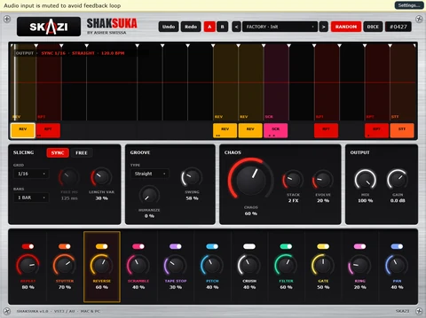</a><br>
      <strong><a href="Shaksuka/">SHAKSUKA</a></strong><br>
      Random chop &amp; glitch FX<br>
      <sub>509 presets</sub>
    </td>
    <td width="33%" valign="top">
      <a href="docs/img/skverb-960.webp">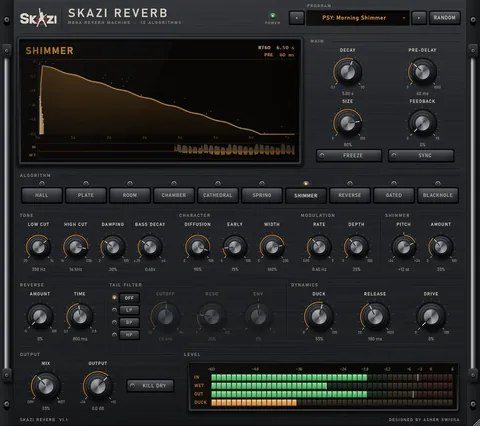</a><br>
      <strong><a href="Skverb/">SKAZI REVERB</a></strong><br>
      Mega reverb machine<br>
      <sub>75 presets</sub>
    </td>
    <td width="33%" valign="top">
      <a href="docs/img/skilter-960.webp">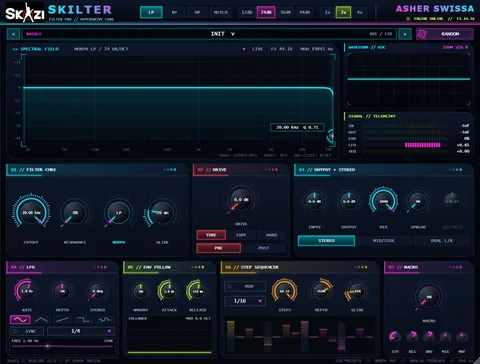</a><br>
      <strong><a href="Skilter/">SKILTER</a></strong><br>
      Morphing multimode filter<br>
      <sub>150 presets</sub>
    </td>
  </tr>
  <tr>
    <td width="33%" valign="top">
      <a href="docs/img/skwide-960.webp">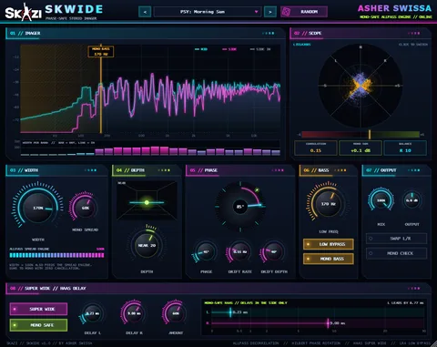</a><br>
      <strong><a href="Skwide/">SKWIDE</a></strong><br>
      Phase-safe stereo imager<br>
      <sub>70 presets</sub>
    </td>
    <td width="33%" valign="top">
      <a href="docs/img/tahini-960.webp">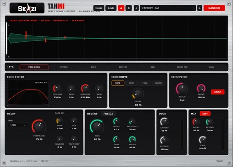</a><br>
      <strong><a href="Tahini/">TAHINI</a></strong><br>
      Space delay + reverb<br>
      <sub>250 presets</sub>
    </td>
    <td width="33%" valign="top">
      <a href="docs/img/filterfish-960.webp">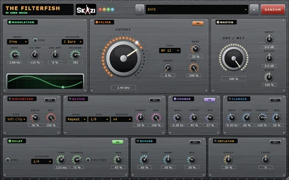</a><br>
      <strong><a href="FilterFish/">THE FILTERFISH</a></strong><br>
      Filter FX<br>
      <sub>800 presets</sub>
    </td>
  </tr>
  <tr>
    <td width="33%" valign="top">
      <a href="docs/img/zhug-960.webp">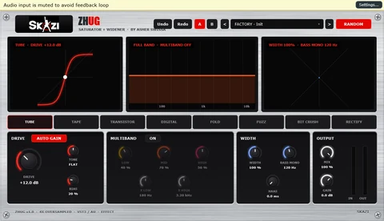</a><br>
      <strong><a href="Zhug/">ZHUG</a></strong><br>
      Saturator + widener<br>
      <sub>118 presets</sub>
    </td>
  </tr>
</tbody>
</table>

### MIDI

<table>
<tbody>
  <tr>
    <td width="33%" valign="top">
      <a href="docs/img/midigod-960.webp">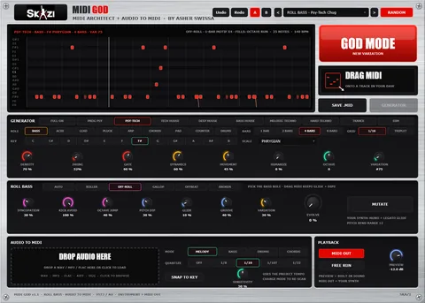</a><br>
      <strong><a href="MidiGod/">MIDI GOD</a></strong><br>
      MIDI pattern generator + audio to MIDI<br>
      <sub>126 presets</sub>
    </td>
  </tr>
</tbody>
</table>

## Try it in your browser

[](https://sergey-bar.github.io/skazi-bundle/?v=50#lab)

Press **Play** to hear *Forest Signal*, a 16-bar psytrance loop built with samples rendered from KICKASS, SUBICH and SKACID. Play the on-screen keys, edit the groove, mix the tracks and export a stereo WAV.

[Open SKAZI Studio](https://sergey-bar.github.io/skazi-bundle/?v=50#lab) · [Watch the project trailer](https://sergey-bar.github.io/skazi-bundle/review/skazi-trailer.html?v=2)

## Troubleshooting

<details>
<summary>Show troubleshooting tips</summary>

- **A plugin is missing.** Check that your DAW scans the right format and rescan. The installer places VST3 plugins in the `SKAZI` subfolder of your system VST3 directory.
- **Where are the files?** On Windows, check `C:\Program Files\Common Files\VST3\SKAZI\` for plugins and `C:\Program Files\SKAZI\` for apps. On Mac, check `/Library/Audio/Plug-Ins/VST3/SKAZI/`, `/Library/Audio/Plug-Ins/Components/` or `/Applications/SKAZI/`.
- **Updating an existing installation.** Download the latest installer from Releases. Plugin IDs are kept stable so existing DAW projects can find the updated plugins. Check the release notes for changes that affect your setup.
- **Uninstalling.** On Windows, remove **SKAZI Bundle** under Installed apps. On Mac, run **Uninstall SKAZI Bundle.command** from `/Applications/SKAZI/`.
- **Reporting a problem.** Include your OS, DAW and version, plugin name and format, bundle version, and the steps to reproduce it. [Open an issue](https://github.com/slazoasher/skazi-bundle/issues/new).

</details>

## Source and builds

<details>
<summary>Show source and build instructions</summary>

The plugins are free to download and the source is available in this repository. The folder links in the collection take you to each plugin's code.

### Windows

Install Visual Studio 2022 with the C++ workload, CMake and Git. From PowerShell in the repository root:

```powershell
.\build_bundle.ps1
```

The installer is written to `dist\SKAZI Bundle Setup.exe`. Use `-PluginsOnly` to build the plugins or `-InstallerOnly` to package a previous build. The installer supports `/silent` and `/uninstall`.

### macOS

From the repository root on a Mac:

```bash
bash mac/build_mac.sh
```

The script builds for Intel and Apple silicon and writes `dist/SKAZI Bundle.pkg`. Both platform builds are also defined in the [bundle workflow](.github/workflows/build-bundle.yml).

### Adding a plugin

1. Add the plugin folder with a JUCE CMake configuration and the **SKAZI** vendor name. Keep existing plugin IDs stable when updating a plugin.
2. Update the platform build scripts, the Windows installer, and the [Mac installer resources](mac/).
3. Add the plugin to the [website catalog](docs/demo/plugins.json) and update the collection in this README.

Shared UI components live in [Common](Common/).

</details>
